<!-- ========================================== -->
<!-- 01. HERO SECTION: SIGNATURE INTRODUCTION   -->
<!-- ========================================== -->

  

<!-- Interactive Telemetry & Social Badges -->

  
  &nbsp;
  
  &nbsp;
  
  &nbsp;
  

 

<!-- ========================================== -->
<!-- 02. CINEMATIC DEVELOPER WORKSTATION        -->
<!-- ========================================== -->

  <h3>💻 &nbsp; Cinematic Developer Workstation</h3>
  
<em>High-precision digital workspace featuring syntax-highlighted execution pipelines, active AI telemetry, and modern IDE workflows.</em>

   
  
    
  

 

<!-- ========================================== -->
<!-- 03. ABOUT ME: MODERN PROFILE CARDS         -->
<!-- ========================================== -->

## 👤 &nbsp; About Me

> I'm a Software Engineer and Full-Stack Developer passionate about building practical software solutions and turning ideas into real-world applications.
>
> My experience spans web and mobile application development, backend systems, API integration, database management, and AI-powered applications.
>
> I enjoy exploring modern technologies, solving engineering challenges, and continuously improving my development skills.

 

<table>
  <tr>
    <td width="50%" valign="top">
      <h4>🎓 &nbsp; Education &amp; Foundation</h4>
      <ul>
        <li><strong>M.Sc. Information Technology</strong></li>
        <li><em>Parvatibai Chowgule College of Arts and Science, Goa</em></li>
        <li>Focused on enterprise software engineering, relational &amp; distributed database architectures, advanced API modeling, and applied AI systems.</li>
      </ul>
    </td>
    <td width="50%" valign="top">
      <h4>💼 &nbsp; Professional Experience</h4>
      <ul>
        <li><strong>Full-Stack Developer Intern</strong> — <em>Infipre IT Services Pvt. Ltd.</em> 
        <small>🗓️ January 2026 – June 2026</small> 
        Building end-to-end full-stack web and mobile systems, robust API workflows, and scalable database integrations.</li>
        <li><strong>Software Engineer Trainee</strong> — <em>Onstro (formerly Teknorix)</em> 
        <small>🗓️ April 2022 – September 2022</small> 
        Engineered web applications, component libraries, and backend service integrations in an agile environment.</li>
      </ul>
    </td>
  </tr>
  <tr>
    <td width="50%" valign="top">
      <h4>🚀 &nbsp; Core Competencies</h4>
      <ul>
        <li><strong>Full-Stack Web:</strong> Responsive frontend architecture, state synchronization, RESTful services, and micro-interactions.</li>
        <li><strong>Cross-Platform Mobile:</strong> High-performance iOS &amp; Android development with React Native &amp; Expo.</li>
        <li><strong>Backend &amp; Security:</strong> Scalable server design, JWT authorization, session defense, and ORM pipelines.</li>
      </ul>
    </td>
    <td width="50%" valign="top">
      <h4>🧠 &nbsp; Engineering Philosophy</h4>
      <ul>
        <li><strong>Code Craftsmanship:</strong> Clean, maintainable, type-safe architecture following SOLID &amp; OOP principles.</li>
        <li><strong>Applied AI:</strong> Integrating LLMs (Google Gemini, Ollama), OCR, and speech transcription into practical automation tools.</li>
        <li><strong>Continuous Iteration:</strong> Obsessed with low latency, rock-solid stability, and intuitive user experiences.</li>
      </ul>
    </td>
  </tr>
</table>

 

  

 

<!-- ========================================== -->
<!-- 04. INTERACTIVE DEVELOPER TERMINAL         -->
<!-- ========================================== -->

  <h3>🖥️ &nbsp; Interactive Developer Terminal</h3>
  
<em>Direct command-line interface runtime inspection detailing environment telemetry, core roles, and technology ecosystem.</em>

   
  
    
  

 

<!-- ========================================== -->
<!-- 05. TECH STACK ECOSYSTEM                   -->
<!-- ========================================== -->

## 🛠️ &nbsp; Technology Ecosystem

Organized by architectural tiers, featuring modern programming languages, full-stack frameworks, databases, and development tooling.

 

<table>
  <thead>
    <tr>
      <th width="28%">Architectural Domain</th>
      <th width="42%">Technologies &amp; Frameworks</th>
      <th width="30%">Visual Iconography</th>
    </tr>
  </thead>
  <tbody>
    <tr>
      <td><strong>Programming Languages</strong></td>
      <td><code>C#</code> &bull; <code>Python</code> &bull; <code>JavaScript</code> &bull; <code>C++</code></td>
      <td>
        
      </td>
    </tr>
    <tr>
      <td><strong>Frontend Development</strong></td>
      <td><code>React.js</code> &bull; <code>React Native</code> &bull; <code>Expo</code> &bull; <code>HTML5</code> &bull; <code>CSS3</code></td>
      <td>
        
      </td>
    </tr>
    <tr>
      <td><strong>Backend Engineering</strong></td>
      <td><code>Node.js</code> &bull; <code>Express.js</code> &bull; <code>ASP.NET</code> &bull; <code>.NET Framework</code></td>
      <td>
        
      </td>
    </tr>
    <tr>
      <td><strong>Databases &amp; Storage</strong></td>
      <td><code>MySQL</code> &bull; <code>MongoDB</code> &bull; <code>Microsoft SQL Server</code> &bull; <code>Firebase Firestore</code></td>
      <td>
        
      </td>
    </tr>
    <tr>
      <td><strong>Tools &amp; Workspaces</strong></td>
      <td><code>Git</code> &bull; <code>GitHub</code> &bull; <code>Postman</code> &bull; <code>VS Code</code> &bull; <code>Visual Studio</code> &bull; <code>MySQL Workbench</code></td>
      <td>
        
      </td>
    </tr>
    <tr>
      <td><strong>Core Concepts &amp; Architecture</strong></td>
      <td><code>REST APIs</code> &bull; <code>Object-Oriented Programming (OOP)</code> &bull; <code>Authentication &amp; Authorization</code> &bull; <code>Database Design</code></td>
      <td>
        
      </td>
    </tr>
  </tbody>
</table>

 

  

 

<!-- ========================================== -->
<!-- 06. FEATURED PROJECTS: SHOWCASE            -->
<!-- ========================================== -->

## 🚀 &nbsp; Featured Engineering Projects

A curated showcase of production applications, distributed backend services, mobile platforms, and AI systems.

 

<table>
  <!-- Project 01 -->
  <tr>
    <td width="100%">
      

        <code>WEB APPLICATION &bull; AI AUTOMATION</code>
        <h3>01 &bull; CRM System Integration</h3>
        
A comprehensive customer relationship management platform engineered with modern full-stack technologies, providing real-time synchronization, communications logging, and AI-driven intelligence summaries.

        

          
          
          
          
          
          
        

        <ul>
          <li><strong>Customer &amp; Order Management:</strong> Centralized client database with order pipelines and communication histories.</li>
          <li><strong>AI Customer Summaries:</strong> Automated generation of executive client profiles and sentiment analysis via Google Gemini.</li>
          <li><strong>Mock Synchronization:</strong> Bi-directional order and catalog sync mocking WooCommerce endpoints.</li>
          <li><strong>Security:</strong> Complete JWT-based authentication guards, hashed credentials, and role-protected routes.</li>
        </ul>
        

          
        

      

    </td>
  </tr>

  <!-- Project 02 -->
  <tr>
    <td width="100%">
      

        <code>CROSS-PLATFORM MOBILE &bull; PRODUCTIVITY</code>
        <h3>02 &bull; SkillPath</h3>
        
A cross-platform learning companion designed for aspiring developers and students to organize curriculum milestones, track modular learning tasks, and sustain consistent daily learning habits.

        

          
          
          
          
        

        <ul>
          <li><strong>Habit &amp; Goal Engineering:</strong> Break down complex study curricula into structured, actionable weekly tasks.</li>
          <li><strong>Cloud Synchronization:</strong> Instant multi-device state persistence powered by Firebase backend services.</li>
          <li><strong>Progress Analytics:</strong> Dynamic velocity tracking, task completion rates, and streak monitoring.</li>
          <li><strong>Push Notifications:</strong> Proactive task reminders and daily motivational touchpoints.</li>
        </ul>
        

          
        

      

    </td>
  </tr>

  <!-- Project 03 -->
  <tr>
    <td width="100%">
      

        <code>ENTERPRISE SECURITY &bull; FULL-STACK</code>
        <h3>03 &bull; Sentinel Grid</h3>
        
An enterprise-grade security guard tracking and duty verification system built to eliminate ghost shifts and ensure accountability across decentralized deployment sites.

        

          
          
          
          
          
          
        

        <ul>
          <li><strong>GPS Attendance Tracking:</strong> Real-time geofenced coordinates verification at designated security checkpoints.</li>
          <li><strong>Selfie Verification:</strong> Secure on-site facial capture uploaded through Cloudinary media pipelines.</li>
          <li><strong>Duty Site Management:</strong> Multi-site roster scheduling, shift assignments, and incident logging.</li>
          <li><strong>Administrative Command Console:</strong> Role-based access control (RBAC) with real-time audit dashboards.</li>
        </ul>
        

          
        

      

    </td>
  </tr>

  <!-- Project 04 -->
  <tr>
    <td width="100%">
      

        <code>MOBILE COMMERCE &bull; FINTECH</code>
        <h3>04 &bull; Art by Heaven</h3>
        
A native mobile e-commerce application crafted for handcrafted art, bespoke home décor, and gifting products with real-time stock sync and seamless payment gateways.

        

          
          
          
          
          
        

        <ul>
          <li><strong>Real-time Product Catalog:</strong> Dynamic category navigation and item showcases hydrated via Cloud Firestore.</li>
          <li><strong>Full Cart Management:</strong> In-app cart calculation, quantity modification, and persistent visitor state.</li>
          <li><strong>Razorpay Integration:</strong> End-to-end encrypted checkout supporting UPI, cards, and net banking.</li>
          <li><strong>Adaptive UI:</strong> Fluid transitions, dark and light theme parity, and optimized image caching.</li>
        </ul>
        

          
        

      

    </td>
  </tr>

  <!-- Project 05 -->
  <tr>
    <td width="100%">
      

        <code>INTELLIGENT PIPELINE &bull; MULTI-MODAL AI</code>
        <h3>05 &bull; HackerRank Orchestrate</h3>
        
An intelligent notification processing and audit pipeline engineered during the 24-hour HackerRank Orchestrate hackathon, combining local LLM reasoning, OCR, and audio transcription.

        

          
          
          
          
        

        <ul>
          <li><strong>Multi-Modal Ingestion:</strong> Ingests WhatsApp notification captures, text messages, receipts, and audio notes.</li>
          <li><strong>Optical &amp; Audio Processing:</strong> High-accuracy text extraction using EasyOCR and audio transcription with Faster Whisper.</li>
          <li><strong>Intelligent Classification:</strong> Contextual intent resolution, financial policy verification, and automated routing via local LLMs.</li>
          <li><strong>Automated Evidence Auditing:</strong> Structured report generation and validation checks against rigorous policy rubrics.</li>
        </ul>
        

          
          &nbsp;
          
        

      

    </td>
  </tr>
</table>

 

  

 

<!-- ========================================== -->
<!-- 07. GITHUB ANALYTICS DASHBOARD             -->
<!-- ========================================== -->

## 📊 &nbsp; GitHub Analytics Dashboard

Real-time telemetry and contribution metrics extracted directly from GitHub activity.

 

  <table border="0">
    <tr>
      <td width="50%" align="center">
        
      </td>
      <td width="50%" align="center">
        
      </td>
    </tr>
  </table>

   

  

    
  

 

<!-- ========================================== -->
<!-- 08. ANIMATED CONTRIBUTION SNAKE            -->
<!-- ========================================== -->

## 🐍 &nbsp; Contribution Trajectory &amp; Activity Stream

Automated graph visualization rendered via `Platane/snk` on every 12-hour cycle.

 

  <picture>
    <source
      media="(prefers-color-scheme: dark)"
      srcset="https://raw.githubusercontent.com/aestheticwolf/aestheticwolf/output/github-contribution-grid-snake-dark.svg"
    />
    <source
      media="(prefers-color-scheme: light)"
      srcset="https://raw.githubusercontent.com/aestheticwolf/aestheticwolf/output/github-contribution-grid-snake.svg"
    />
    
  </picture>

    
  

 

<!-- ========================================== -->
<!-- 09. CONNECT WITH ME                        -->
<!-- ========================================== -->

## 🌐 &nbsp; Connect With Me

Whether you want to discuss full-stack opportunities, modern software architecture, mobile engineering, or cutting-edge AI integrations — let's build something extraordinary together.

 

  
  &nbsp;&nbsp;
  
  &nbsp;&nbsp;
  

    

 

<!-- ========================================== -->
<!-- 10. SIGNATURE FOOTER                       -->
<!-- ========================================== -->

  

    

  
  
    
  &copy; 2026 Richard D'Souza &bull; Built with pure SVG, GitHub Actions, and modern engineering standards.

