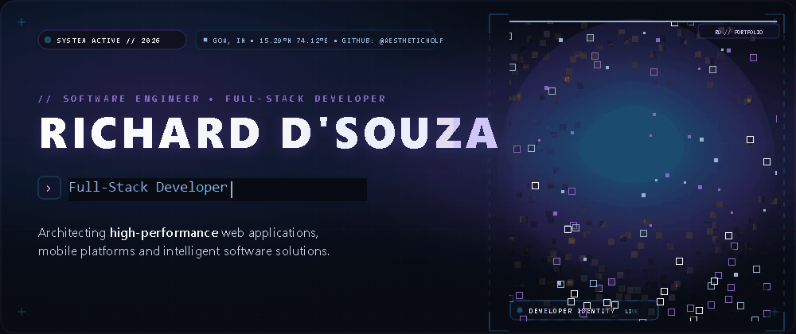
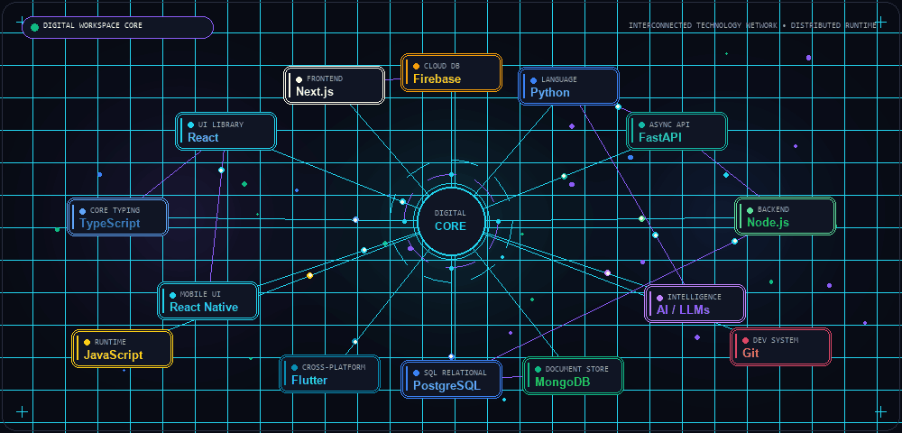
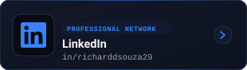
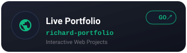

<!-- ========================================== -->
<!-- 01. HERO BANNER                            -->
<!-- ========================================== -->

<a href="https://github.com/aestheticwolf">
  <picture>
    <source media="(prefers-color-scheme: dark)" srcset="./assets/hero.gif" />
    <source media="(prefers-color-scheme: light)" srcset="./assets/hero.gif" />
    
  </picture>
</a>

  

<!-- Action Bar & Telemetry Links -->

  
  &nbsp;
  
  &nbsp;
  
  &nbsp;
  

  

<!-- ========================================== -->
<!-- 02. DEVELOPER WORKSPACE                    -->
<!-- ========================================== -->

  

 

  <picture>
    <source media="(prefers-color-scheme: dark)" srcset="./assets/workspace-network.gif" />
    <source media="(prefers-color-scheme: light)" srcset="./assets/workspace-network.gif" />
    
  </picture>

  

<!-- ========================================== -->
<!-- 03. ABOUT & PROFESSIONAL BACKGROUND        -->
<!-- ========================================== -->

  

 

  

  

<!-- ========================================== -->
<!-- 04. TECHNOLOGY ECOSYSTEM                   -->
<!-- ========================================== -->

  

 

  

 

<!-- Categorized Technical Breakdown -->
| Category | Core Technologies |
| :--- | :--- |
| **Languages** | TypeScript, JavaScript, Python, Dart, C/C++ |
| **Frontend** | React, Next.js, HTML5, CSS3, Tailwind CSS |
| **Mobile** | React Native, Flutter, Expo |
| **Backend** | Node.js, Express.js, FastAPI, REST APIs |
| **Databases &amp; Cloud** | PostgreSQL, MongoDB, Firebase, Cloud Firestore, Cloudinary |
| **Tools** | Git, GitHub, VS Code, Postman, Linux |

  

<!-- ========================================== -->
<!-- 05. SELECTED PROJECTS                      -->
<!-- ========================================== -->

  

 

<!-- PROJECT 01: SKILLPATH -->
<table>
  <tr>
    <td width="48%" align="center" valign="middle">
      
    </td>
    <td width="52%" valign="middle">
      <h3><a href="https://github.com/aestheticwolf/SkillCompanionApp" target="_blank">01 &bull; SkillPath</a></h3>
      
A mobile companion application built with <code>React Native</code> and <code>Expo</code> designed to track structured learning goals, record active daily streaks, and synchronize user progress via <code>Firebase</code>.

      
<strong>Stack:</strong> <code>React Native</code> &bull; <code>Expo</code> &bull; <code>TypeScript</code> &bull; <code>Cloud Firestore</code>

      <ul>
        <li><strong>Milestone Tracking:</strong> Structured goal progression with automated daily streak calculation.</li>
        <li><strong>State Synchronization:</strong> Cross-device state persistence powered by Cloud Firestore.</li>
        <li><strong>Reminders:</strong> Local and push notification scheduling to sustain regular study routines.</li>
      </ul>
      

        
      

    </td>
  </tr>
</table>

 

<!-- PROJECT 02: SENTINEL GRID -->
<table>
  <tr>
    <td width="52%" valign="middle">
      <h3><a href="https://github.com/aestheticwolf/security-guard-tracking-system" target="_blank">02 &bull; Sentinel Grid</a></h3>
      
An on-site workforce operations platform built with <code>React.js</code>, <code>Node.js</code>, <code>Express.js</code>, and <code>MongoDB</code> to coordinate guard deployments, verify site presence, and manage shift rosters.

      
<strong>Stack:</strong> <code>React.js</code> &bull; <code>Node.js</code> &bull; <code>Express.js</code> &bull; <code>MongoDB</code> &bull; <code>JWT</code> &bull; <code>Cloudinary</code>

      <ul>
        <li><strong>Geofenced Check-Ins:</strong> Real-time GPS coordinate validation at designated patrol locations.</li>
        <li><strong>Photo Verification:</strong> On-site selfie capture uploaded directly via Cloudinary media pipelines.</li>
        <li><strong>Admin Dashboard:</strong> Shift scheduling, active guard monitoring, and JWT-authenticated access.</li>
      </ul>
      

        
      

    </td>
    <td width="48%" align="center" valign="middle">
      
    </td>
  </tr>
</table>

 

<!-- PROJECT 03: ART BY HEAVEN -->
<table>
  <tr>
    <td width="48%" align="center" valign="middle">
      
    </td>
    <td width="52%" valign="middle">
      <h3><a href="https://github.com/aestheticwolf/art-of" target="_blank">03 &bull; Art by Heaven</a></h3>
      
A mobile e-commerce application built with <code>Flutter</code> and <code>Cloud Firestore</code> offering live art catalog discovery, persistent shopping cart management, and online payment processing.

      
<strong>Stack:</strong> <code>Flutter</code> &bull; <code>Firebase</code> &bull; <code>Cloud Firestore</code> &bull; <code>Cloud Functions</code> &bull; <code>Razorpay</code>

      <ul>
        <li><strong>Live Catalog:</strong> Real-time artwork listings, category filtering, and image asset hydration.</li>
        <li><strong>Cart Management:</strong> Local state persistence with dynamic subtotal and quantity calculation.</li>
        <li><strong>Payment Integration:</strong> Checkout workflow supporting UPI, cards, and webhooks via Razorpay.</li>
      </ul>
      

        
      

    </td>
  </tr>
</table>

  

<!-- ========================================== -->
<!-- 06. GITHUB ANALYTICS DASHBOARD             -->
<!-- ========================================== -->

  

 

  <!-- ROW 1: GITHUB STATS & MOST USED LANGUAGES -->
  <table border="0" cellpadding="0" cellspacing="8" width="100%">
    <tr>
      <td width="50%" align="center" valign="top">
        
      </td>
      <td width="50%" align="center" valign="top">
        
      </td>
    </tr>
  </table>

   

  <!-- ROW 2: CONTRIBUTION STREAK SHOWCASE -->
  

  

<!-- ========================================== -->
<!-- 07. CONTRIBUTION TRAJECTORY                -->
<!-- ========================================== -->

  

 

  <picture>
    <source
      media="(prefers-color-scheme: dark)"
      srcset="./assets/github-contribution-grid-snake-dark.svg"
    />
    <source
      media="(prefers-color-scheme: light)"
      srcset="https://raw.githubusercontent.com/aestheticwolf/aestheticwolf/output/github-contribution-grid-snake.svg"
    />
    
  </picture>

  

<!-- ========================================== -->
<!-- 08. CONNECT WITH ME                        -->
<!-- ========================================== -->

<table border="0" cellpadding="0" cellspacing="8" width="100%">
  <tr>
    <td width="33.3%" align="center">
      
    </td>
    <td width="33.3%" align="center">
      
    </td>
    <td width="33.3%" align="center">
      
    </td>
  </tr>
</table>

 

<!-- SIGNATURE FOOTER & BACK TO TOP -->

  
    
  

