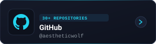

<!-- ========================================== -->
<!-- 01. PREMIUM HERO SECTION                   -->
<!-- ========================================== -->

  

<!-- Editorial Action Bar & Telemetry -->

  
  &nbsp;
  
  &nbsp;
  
  &nbsp;
  

  

<!-- ========================================== -->
<!-- 02. DEVELOPER WORKSPACE                    -->
<!-- ========================================== -->

  <small><code>02 // RUNTIME &bull; DEV WORKSPACE &amp; HARDWARE</code></small>
  <h2>DEVELOPER WORKSPACE</h2>
  
<em>"A high-performance engineering environment tailored for speed, precision, and modern full-stack workflows."</em>

 

  

  

<!-- ========================================== -->
<!-- 03. ABOUT & PROFESSIONAL BACKGROUND        -->
<!-- ========================================== -->

  <small><code>03 // IDENTITY &bull; ACADEMIC RIGOR &amp; PRODUCTION ENGINEERING</code></small>
  <h2>ABOUT &amp; PROFESSIONAL BACKGROUND</h2>
  
<em>"Merging academic computer science rigor with production full-stack engineering."</em>

 

  

  

<!-- ========================================== -->
<!-- 04. TECHNOLOGY ECOSYSTEM                   -->
<!-- ========================================== -->

  <small><code>04 // ARCHITECTURE &bull; 5 TIERS &bull; 19 PRODUCTION TECHNOLOGIES</code></small>
  <h2>TECHNOLOGY ECOSYSTEM</h2>
  
<em>"Official production technology stack across core languages, frontend, backend, databases, and tooling."</em>

 

  

  

<!-- ========================================== -->
<!-- 05. SELECTED PROJECTS SHOWCASE             -->
<!-- ========================================== -->

  <small><code>05 // SHOWCASE &bull; FEATURED PRODUCTION REPOSITORIES</code></small>
  <h2>SELECTED PROJECTS</h2>
  
<em>"Engineering ideas into robust, user-centric, and scalable digital realities."</em>

 

<!-- PROJECT 01: SKILLPATH (Visual Left, Content Right) -->
<table>
  <tr>
    <td width="48%" align="center" valign="middle">
      
    </td>
    <td width="52%" valign="middle">
      <small><code>CROSS-PLATFORM MOBILE &bull; LEARNING SYSTEM</code></small>
      <h3>01 &bull; SkillPath</h3>
      
A cross-platform mobile companion engineered with <code>React Native</code> and <code>Expo</code> to manage structured learning goals, track active streaks, and synchronize user state via <code>Firebase</code>.

      

        
        
        
        
      

      <ul>
        <li><strong>Goal Progression:</strong> Modular milestone decomposition with dynamic daily streak tracking.</li>
        <li><strong>Cloud Synchronization:</strong> Instant cross-device state persistence powered by Cloud Firestore.</li>
        <li><strong>Habit Retention:</strong> Proactive push notification workflows sustaining daily learner engagement.</li>
      </ul>
      

        
      

    </td>
  </tr>
</table>

 

<!-- PROJECT 02: SENTINEL GRID (Content Left, Visual Right) -->
<table>
  <tr>
    <td width="52%" valign="middle">
      <small><code>WORKFORCE OPERATIONS &bull; FULL-STACK SECURITY</code></small>
      <h3>02 &bull; Sentinel Grid</h3>
      
A workforce management platform engineered with <code>React.js</code>, <code>Node.js</code>, and <code>MongoDB</code> to streamline on-site security deployments via geofenced GPS verification and biometric check-ins.

      

        
        
        
        
        
        
      

      <ul>
        <li><strong>GPS Geofenced Tracking:</strong> Real-time coordinates verification at designated security checkpoints.</li>
        <li><strong>Selfie Verification:</strong> Tamper-resistant on-site photo check-ins via Cloudinary image pipelines.</li>
        <li><strong>Admin Command Center:</strong> Multi-site roster scheduling with JWT-based role separation.</li>
      </ul>
      

        
      

    </td>
    <td width="48%" align="center" valign="middle">
      
    </td>
  </tr>
</table>

 

<!-- PROJECT 03: ART BY HEAVEN (Visual Left, Content Right) -->
<table>
  <tr>
    <td width="48%" align="center" valign="middle">
      
    </td>
    <td width="52%" valign="middle">
      <small><code>MOBILE E-COMMERCE &bull; FINTECH INTEGRATION</code></small>
      <h3>03 &bull; Art by Heaven</h3>
      
A mobile e-commerce platform built with <code>Flutter</code> and <code>Cloud Firestore</code> delivering smooth art catalog exploration, cart management, and secure payments via <code>Razorpay</code>.

      

        
        
        
        
        
      

      <ul>
        <li><strong>Real-time Catalog:</strong> Live inventory hydration and category discovery via Cloud Firestore.</li>
        <li><strong>Cart Management:</strong> In-app subtotal calculation, quantity controls, and client persistence.</li>
        <li><strong>Razorpay Integration:</strong> End-to-end encrypted checkout supporting UPI, cards, and webhooks.</li>
      </ul>
      

        
      

    </td>
  </tr>
</table>

  

<!-- ========================================== -->
<!-- 06. GITHUB ANALYTICS DASHBOARD             -->
<!-- ========================================== -->

  <small><code>06 // TELEMETRY &bull; GITHUB ACTIVITY &amp; METRICS</code></small>
  <h2>GITHUB ANALYTICS</h2>
  
<em>"An overview of my development activity, repositories, and contribution history."</em>

 

  <!-- ROW 1: GITHUB STATS & MOST USED LANGUAGES -->
  <table border="0" cellpadding="0" cellspacing="8" width="100%">
    <tr>
      <td width="50%" align="center" valign="top">
        
      </td>
      <td width="50%" align="center" valign="top">
        
      </td>
    </tr>
  </table>

   

  <!-- ROW 2: CONTRIBUTION STREAK SHOWCASE (Total Contributions | Current Streak | Longest Streak) -->
  

  

<!-- ========================================== -->
<!-- 07. CONTRIBUTION TRAJECTORY                -->
<!-- ========================================== -->

  <small><code>07 // TRAJECTORY &bull; 52-WEEK COMMIT STREAM</code></small>
  <h2>CONTRIBUTION TRAJECTORY</h2>
  
<em>"Every contribution represents another step in my development journey."</em>

 

  <picture>
    <source
      media="(prefers-color-scheme: dark)"
      srcset="./assets/github-contribution-grid-snake-dark.svg"
    />
    <source
      media="(prefers-color-scheme: light)"
      srcset="https://raw.githubusercontent.com/aestheticwolf/aestheticwolf/output/github-contribution-grid-snake.svg"
    />
    
  </picture>

  

<!-- ========================================== -->
<!-- 08. CONTACT & SIGNATURE FOOTER             -->
<!-- ========================================== -->

  <!-- CONTACT HERO BANNER -->
  

 

<!-- THREE INTERACTIVE SOCIAL CARDS -->
<table border="0" cellpadding="0" cellspacing="8" width="100%">
  <tr>
    <td width="33.3%" align="center">
      
    </td>
    <td width="33.3%" align="center">
      
    </td>
    <td width="33.3%" align="center">
      
    </td>
  </tr>
</table>

 

<!-- SIGNATURE FOOTER & BACK TO TOP -->

  
    
  

