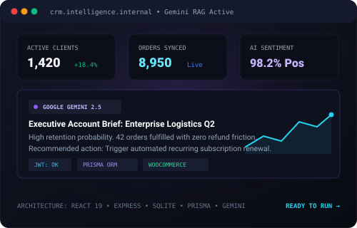
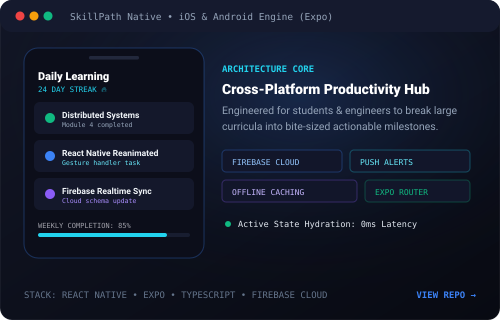
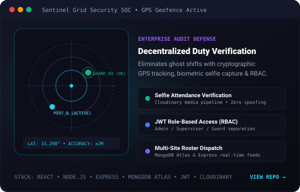
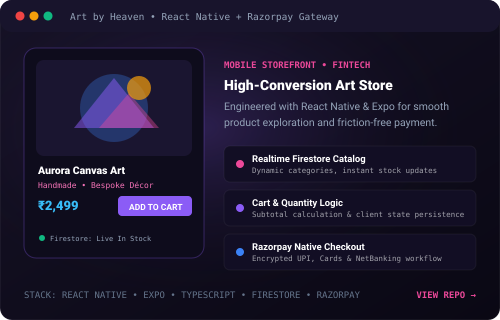
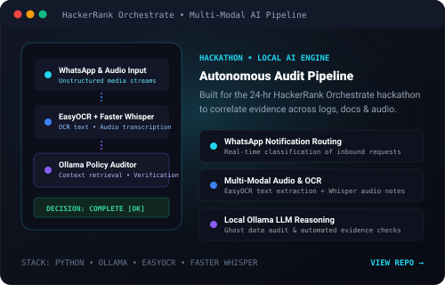

<!-- ========================================== -->
<!-- 01. PREMIUM HERO SECTION                   -->
<!-- ========================================== -->

  

<!-- Editorial Action Bar & Telemetry -->

  
  &nbsp;
  
  &nbsp;
  
  &nbsp;
  

 

<!-- ========================================== -->
<!-- 02. SIGNATURE LAPTOP WORKSPACE             -->
<!-- ========================================== -->

## 💻 &nbsp; Signature Developer Workspace

> High-precision development workstation combining active React &amp; TypeScript engineering pipelines, Google Gemini AI orchestration, and an integrated real-time CLI terminal session.

 

  

 

<!-- ========================================== -->
<!-- 03. ABOUT & PROFESSIONAL BACKGROUND        -->
<!-- ========================================== -->

## 👤 &nbsp; About &amp; Professional Background

> I'm a Software Engineer and Full-Stack Developer passionate about building practical software solutions and turning ideas into real-world applications.
>
> My experience spans web and mobile application development, backend systems, API integration, database management, and AI-powered applications. I enjoy exploring modern technologies, solving engineering challenges, and continuously improving my development skills.

 

<table>
  <tr>
    <td width="33%" valign="top">
      <h4>🎓 &nbsp; Education</h4>
      
<strong>M.Sc. Information Technology</strong> 
      <em>Parvatibai Chowgule College of Arts and Science, Goa</em>

      
<small>Advanced focus on software architecture, distributed databases, robust API modeling, and applied AI systems.</small>

    </td>
    <td width="34%" valign="top">
      <h4>💼 &nbsp; Professional Experience</h4>
      
<strong>Full-Stack Developer Intern</strong> 
      <em>Infipre IT Services Pvt. Ltd.</em> &bull; <small>Jan 2026 – Jun 2026</small>

      
<strong>Software Engineer Trainee</strong> 
      <em>Onstro (formerly Teknorix)</em> &bull; <small>Apr 2022 – Sep 2022</small>

    </td>
    <td width="33%" valign="top">
      <h4>🎯 &nbsp; Core Focus Areas</h4>
      <ul>
        <li><strong>Full-Stack Web</strong> (React, Node, Express)</li>
        <li><strong>Cross-Platform Mobile</strong> (React Native, Expo)</li>
        <li><strong>Backend &amp; Database Architecture</strong></li>
        <li><strong>Applied AI &amp; Intelligent Automation</strong></li>
      </ul>
    </td>
  </tr>
</table>

 

<!-- ========================================== -->
<!-- 04. TECHNOLOGY ECOSYSTEM                   -->
<!-- ========================================== -->

## 🛠️ &nbsp; Technology Ecosystem

A clean architectural overview of core programming languages, frameworks, databases, and development tooling.

 

<table>
  <thead>
    <tr>
      <th width="30%">Architectural Tier</th>
      <th width="70%">Technology Stack &amp; Visual Iconography</th>
    </tr>
  </thead>
  <tbody>
    <tr>
      <td><strong>Programming Languages</strong></td>
      <td>
        
      </td>
    </tr>
    <tr>
      <td><strong>Frontend Development</strong></td>
      <td>
        
      </td>
    </tr>
    <tr>
      <td><strong>Backend Engineering</strong></td>
      <td>
        
      </td>
    </tr>
    <tr>
      <td><strong>Databases &amp; Storage</strong></td>
      <td>
        
      </td>
    </tr>
    <tr>
      <td><strong>Tools &amp; Workspaces</strong></td>
      <td>
        
      </td>
    </tr>
  </tbody>
</table>

 

<!-- ========================================== -->
<!-- 05. SELECTED PROJECTS SHOWCASE             -->
<!-- ========================================== -->

## 🚀 &nbsp; Selected Projects

An alternating editorial showcase of production applications, distributed backend services, mobile platforms, and AI systems.

 

<!-- PROJECT 01: CRM SYSTEM INTEGRATION (Visual Left, Content Right) -->
<table>
  <tr>
    <td width="46%" align="center" valign="middle">
      
    </td>
    <td width="54%" valign="middle">
      <small><code>WEB APPLICATION &bull; AI AUTOMATION</code></small>
      <h3>01 &bull; CRM System Integration</h3>
      
A customer management platform engineered with modern full-stack technologies, providing real-time synchronization, communications logging, and AI-driven intelligence summaries.

      

        
        
        
        
        
        
      

      <ul>
        <li><strong>AI Summaries:</strong> Automated client profiles &amp; sentiment analysis via Google Gemini.</li>
        <li><strong>Order Pipelines:</strong> Centralized client database with order tracking &amp; communication history.</li>
        <li><strong>WooCommerce Sync:</strong> Mock endpoint synchronization with JWT route protection.</li>
      </ul>
      

        
      

    </td>
  </tr>
</table>

 

<!-- PROJECT 02: SKILLPATH (Content Left, Visual Right) -->
<table>
  <tr>
    <td width="54%" valign="middle">
      <small><code>CROSS-PLATFORM MOBILE &bull; PRODUCTIVITY</code></small>
      <h3>02 &bull; SkillPath</h3>
      
A cross-platform learning companion designed for aspiring engineers to break down learning goals into manageable tasks, track progress analytics, and sustain daily habits.

      

        
        
        
        
      

      <ul>
        <li><strong>Goal Tracking:</strong> Modular milestone decomposition with dynamic streak tracking.</li>
        <li><strong>Cloud Synchronization:</strong> Instant cross-device state persistence powered by Firebase.</li>
        <li><strong>Proactive Reminders:</strong> Push notification workflows keeping learners engaged.</li>
      </ul>
      

        
      

    </td>
    <td width="46%" align="center" valign="middle">
      
    </td>
  </tr>
</table>

 

<!-- PROJECT 03: SENTINEL GRID (Visual Left, Content Right) -->
<table>
  <tr>
    <td width="46%" align="center" valign="middle">
      
    </td>
    <td width="54%" valign="middle">
      <small><code>ENTERPRISE SECURITY &bull; FULL-STACK</code></small>
      <h3>03 &bull; Sentinel Grid</h3>
      
An enterprise-grade security guard tracking and duty verification system built to eliminate ghost shifts and ensure operational transparency across decentralized duty locations.

      

        
        
        
        
        
      

      <ul>
        <li><strong>GPS Geofenced Tracking:</strong> Real-time coordinates verification at designated security checkpoints.</li>
        <li><strong>Selfie Verification:</strong> Tamper-resistant on-site photo check-ins via Cloudinary pipelines.</li>
        <li><strong>Admin Command Center:</strong> Multi-site roster scheduling with JWT-based role separation.</li>
      </ul>
      

        
      

    </td>
  </tr>
</table>

 

<!-- PROJECT 04: ART BY HEAVEN (Content Left, Visual Right) -->
<table>
  <tr>
    <td width="54%" valign="middle">
      <small><code>MOBILE COMMERCE &bull; FINTECH</code></small>
      <h3>04 &bull; Art by Heaven</h3>
      
A native mobile e-commerce application crafted for handcrafted art, décor, and gifting products, offering fluid catalog browsing and friction-free payment checkouts.

      

        
        
        
        
        
      

      <ul>
        <li><strong>Real-time Catalog:</strong> Live inventory hydration and category filtering via Cloud Firestore.</li>
        <li><strong>Cart Management:</strong> In-app subtotal calculation, quantity controls, and client persistence.</li>
        <li><strong>Razorpay Integration:</strong> End-to-end encrypted checkout supporting UPI and cards.</li>
      </ul>
      

        
      

    </td>
    <td width="46%" align="center" valign="middle">
      
    </td>
  </tr>
</table>

 

<!-- PROJECT 05: HACKERRANK ORCHESTRATE (Visual Left, Content Right) -->
<table>
  <tr>
    <td width="46%" align="center" valign="middle">
      
    </td>
    <td width="54%" valign="middle">
      <small><code>INTELLIGENT PIPELINE &bull; MULTI-MODAL AI</code></small>
      <h3>05 &bull; HackerRank Orchestrate</h3>
      
An autonomous notification processing and deletion auditing pipeline engineered during the 24-hour HackerRank hackathon, correlating evidence across multi-modal data streams.

      

        
        
        
        
      

      <ul>
        <li><strong>Multi-Modal Extraction:</strong> EasyOCR text extraction and Faster Whisper voice transcription.</li>
        <li><strong>Intelligent Classification:</strong> Contextual intent resolution and notification routing via local LLMs.</li>
        <li><strong>Evidence Audit Engine:</strong> Automated policy checks detecting ghost data across databases &amp; logs.</li>
      </ul>
      

        
        &nbsp;
        
      

    </td>
  </tr>
</table>

 

<!-- ========================================== -->
<!-- 06. GITHUB ANALYTICS DASHBOARD             -->
<!-- ========================================== -->

## 📊 &nbsp; GitHub Analytics Dashboard

A unified dark dashboard displaying repository performance, language distribution, and commit trajectory.

 

  <table border="0">
    <tr>
      <td width="50%" align="center">
        
      </td>
      <td width="50%" align="center">
        
      </td>
    </tr>
  </table>

   

  

 

<!-- ========================================== -->
<!-- 07. CONTRIBUTION SNAKE                     -->
<!-- ========================================== -->

## 🐍 &nbsp; Contribution Trajectory

Automated contribution snake animation generated via Platane/snk every 12 hours.

 

  <picture>
    <source
      media="(prefers-color-scheme: dark)"
      srcset="https://raw.githubusercontent.com/aestheticwolf/aestheticwolf/output/github-contribution-grid-snake-dark.svg"
    />
    <source
      media="(prefers-color-scheme: light)"
      srcset="https://raw.githubusercontent.com/aestheticwolf/aestheticwolf/output/github-contribution-grid-snake.svg"
    />
    
  </picture>

 

<!-- ========================================== -->
<!-- 08. CONTACT & SIGNATURE FOOTER             -->
<!-- ========================================== -->

## 🌐 &nbsp; Connect With Me

Whether you want to discuss full-stack engineering, mobile development, or applied AI systems — let's build something extraordinary together.

 

  

    
    &nbsp;&nbsp;
    
    &nbsp;&nbsp;
    
  

   

  <!-- Signature Footer SVG -->
  

    

  

